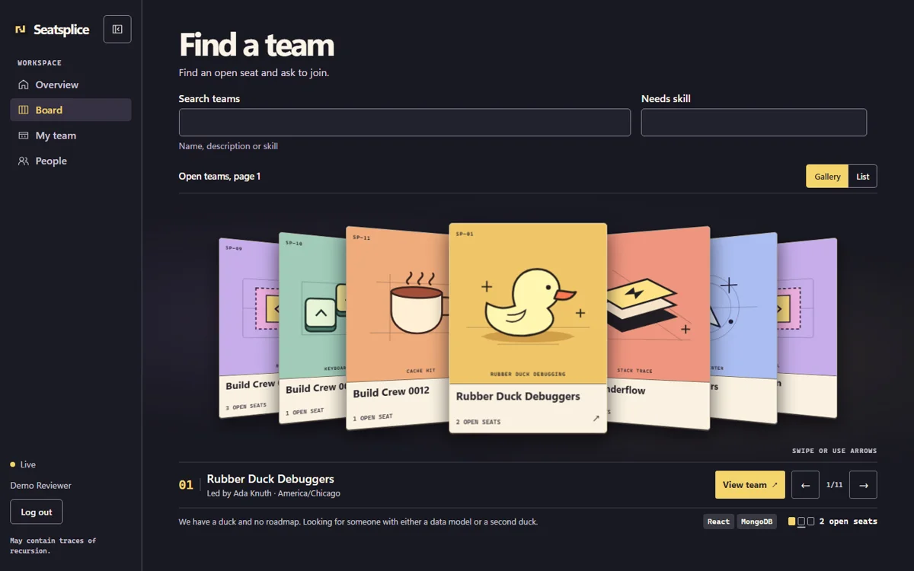

# Seatsplice

**Find your people.** Seatsplice is a live team finder for [Hack4Hack’s PS1 challenge](https://hack4hack.com/hackathons/hack4hack-crew-hiring-challenge-2026-tp3m). Discover open seats, ask to join, or start a team. The board updates when a seat is taken.



The hard part is the last seat. In two automated races, 50 approvals and 50 separate invite holders each competed for one opening across two app instances. Exactly one claim succeeded in each race. The [local load report](docs/LOAD-TEST.md) covers 100 concurrent participants against a database seeded with 10,000 users and 2,000 teams.

## Run it

Use Node.js 22 or later. Node 24 is the tested version. From the repository root:

```sh
npm ci
npm run build
npm run demo -- --seed
```

Open http://127.0.0.1:4173 and create an account. The preview runs on loopback and starts a temporary MongoDB replica set. On the first run it may download a MongoDB binary. The sample crews show what a busy board looks like. Their fictional owners cannot sign in. To exercise approvals, create your own team, open a second browser profile or private window, register a different account, and request a seat. Stop the preview with Ctrl+C.

For a persistent development database, copy `.env.example` to `.env`, point it at a MongoDB replica set, then run `npm run dev` and `npm run ui` in separate terminals. Open the Vite URL at `http://localhost:5173`. The API is proxied through Vite.

## Verify it

```sh
npm test
npx playwright install chromium
npm run build
npm run test:browser
npm run load
```

The API tests use a temporary MongoDB replica set and two HTTP app instances. The browser suite drives the built app on loopback. Install [k6](https://grafana.com/docs/k6/latest/set-up/install-k6/) for the load test or set `K6_BIN` to its executable. The runner starts its own local database, seeds 10,000 fictional participants and 2,000 teams, and runs the checked-in scenario against that local server. `npm run seed` is also available for a database whose name ends in `_fixtures`.

## Deploy

The production build serves React and the Express API on one origin. Use a MongoDB replica set or MongoDB Atlas with a dedicated application database user. Keep `MONGO_URL` and `INVITE_SECRET` in your host's secret settings. Generate the latter with `node -e "console.log(require('node:crypto').randomBytes(32).toString('hex'))"`. Keep the same invite secret across instances and restarts.

The [Render blueprint](render.yaml) supplies the build and start commands, HTTP health check, and environment configuration. It generates the invite secret on Render. Follow the [free deployment guide](docs/DEPLOY.md) to connect the database and verify the public demo.

For another host, set `NODE_ENV=production`, `APP_ORIGIN` to the public HTTPS origin, and `TRUST_PROXY` to the exact trusted proxy hop count. Set the database and invite secrets, build with `npm ci --include=dev && npm run build`, then start with `npm start`.

## Submission notes

- [Design note](docs/DESIGN.md)
- [Benchmark report](docs/LOAD-TEST.md)
- [Walkthrough outline](docs/WALKTHROUGH.md)
- [Security review and tested boundaries](docs/SECURITY.md)
- [Design and tooling references](docs/RESOURCES.md)

The app uses original product code with standard open-source libraries. Claude Code contributed the React client and reviewed the backend. Codex implemented the backend, regression tests, and final design and verification passes. Reviewers can reproduce the last-seat proof by running `npm test` and inspecting the named concurrency case in `tests/api.test.js`.
